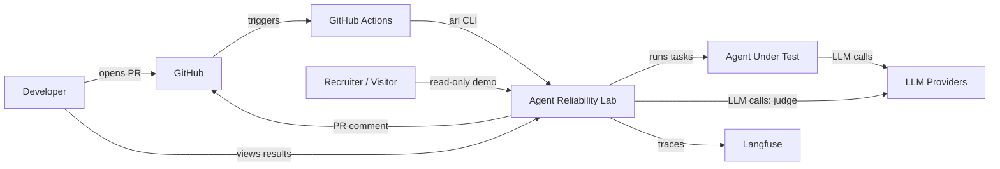
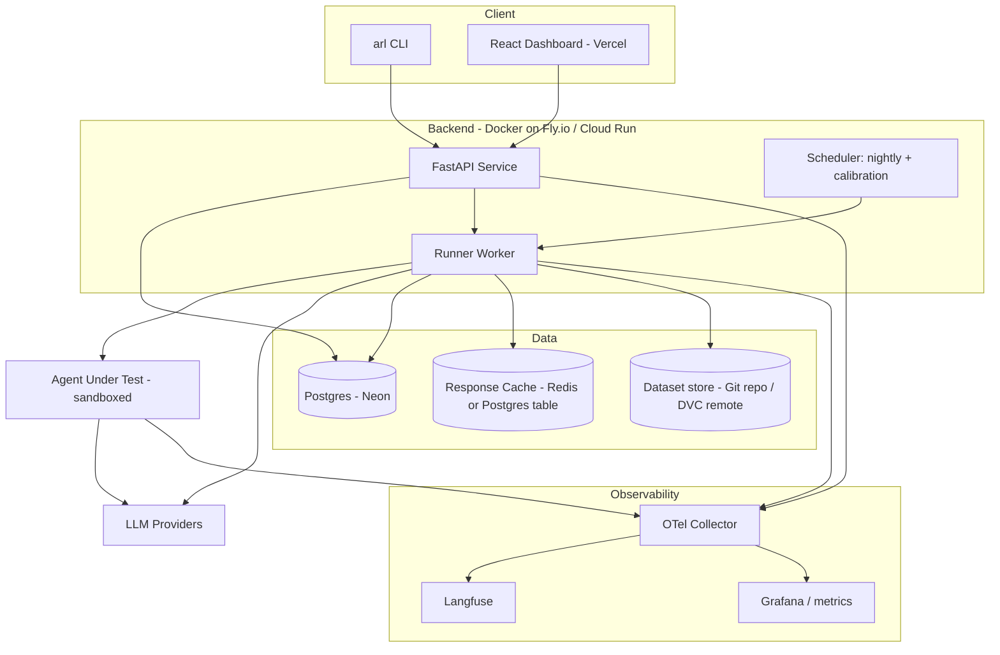
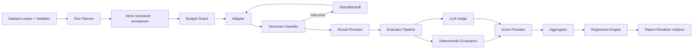
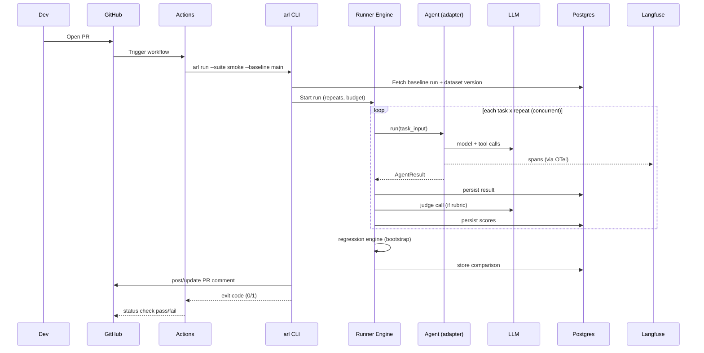
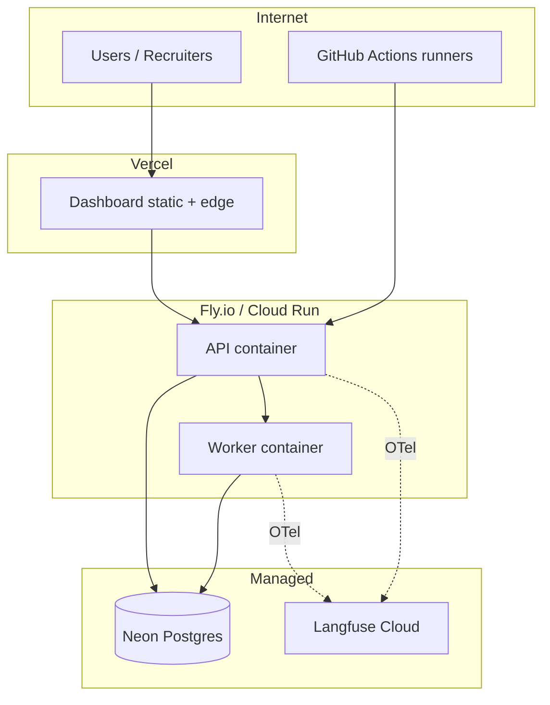

# Architecture Document

**Project:** Agent Reliability Lab (ARL)
**Version:** 1.0
**Related:** `prd.md`, `design.md`, `security.md`

Diagrams use Mermaid, which GitHub renders natively.

---

## 1. Architectural Goals and Drivers

| Driver | Architectural consequence |
|---|---|
| Trustworthy scores | Evaluation logic isolated in its own module with versioned evaluators and stored judge prompts |
| Reproducibility | Immutable dataset versions; every run stores full config and fingerprints |
| Cheap to operate | Serverless/low-cost hosting, scale-to-zero API, response caching in CI |
| Diagnosability | OpenTelemetry traces across runner, agent, and judge; trace IDs stored with results |
| Framework neutrality | Adapter boundary between lab and agent |
| Safe execution | Agent under test runs with mocked tools, restricted network, and spend caps |
| Public demo | Read-only mode with seeded data, separate from write path |

---

## 2. System Context (C4 Level 1)



External systems: GitHub, LLM providers (OpenAI/Anthropic), Langfuse, Postgres host.

---

## 3. Container View (C4 Level 2)



### Container responsibilities

| Container | Tech | Responsibility |
|---|---|---|
| CLI | Python, Typer | Developer and CI entrypoint; talks to API or runs the engine in-process for CI |
| API | FastAPI, SQLAlchemy, Alembic | CRUD, run orchestration requests, comparisons, auth, read endpoints |
| Runner worker | Python, asyncio | Executes runs, evaluators, regression engine |
| Scheduler | GitHub Actions cron (v1) or APScheduler | Nightly full suite, weekly judge calibration |
| Dashboard | React, TS, Tailwind | Visualization; read-only for public demo |
| Postgres | Neon/Supabase | System of record |
| Cache | Postgres table (v1), Redis optional | Memoized LLM responses |
| OTel Collector | OpenTelemetry | Receives spans, forwards to Langfuse and metrics backend |
| Langfuse | Cloud or self-hosted | Trace UI |

**CI mode:** In GitHub Actions the CLI runs the engine in-process (no long-lived worker needed) and writes results to the API/DB. This keeps PR runs simple and cheap. **Service mode:** API enqueues runs for the worker, used for manual and dashboard-triggered runs.

---

## 4. Component View: Runner (C4 Level 3)



---

## 5. Data Flow: A Pull Request Run



---

## 6. Deployment Architecture



### Environments

| Env | Purpose | Data | Deploy trigger |
|---|---|---|---|
| local | Development | docker compose Postgres, Langfuse optional | manual |
| staging | Integration checks, pre-release | separate DB, cheap models | merge to `main` |
| production | Public demo and real runs | prod DB, seeded demo dataset | git tag / manual promote |

### Infrastructure as code
Dockerfiles and `docker-compose.yml` in `infra/`; platform config (`fly.toml` or Cloud Run YAML) in `infra/`. Database migrations run as a release step, never at app startup in production.

---

## 7. Technology Stack and Rationale

| Concern | Choice | Why | Alternatives considered |
|---|---|---|---|
| Language (backend) | Python 3.12 | AI ecosystem, async support | Node/TS |
| API | FastAPI | Async, typed, OpenAPI | Flask, Django |
| DB | Postgres | Concurrent writes, JSONB, deploy story | SQLite |
| ORM/migrations | SQLAlchemy 2 + Alembic | Mature, typed | Prisma |
| Concurrency | asyncio + semaphore | Fits I/O-bound LLM calls | Celery |
| Tracing | OpenTelemetry + Langfuse | Open standard, strong LLM UI | LangSmith (lock-in) |
| Stats | NumPy/SciPy | Bootstrap, Fisher exact | custom |
| Agent framework | LangGraph | Graph state, easy tracing | CrewAI, custom |
| Dashboard | React, TS, Tailwind, TanStack Query, Recharts | Fast to build, hireable stack | Streamlit |
| CI | GitHub Actions | Native PR integration | CircleCI |
| Hosting | Fly.io/Cloud Run, Vercel, Neon | Free/cheap tiers | AWS ECS |
| Datasets | YAML in Git (+DVC optional) | Diffable, reviewable | DB-only |
| Lint/type | ruff, mypy, pre-commit | Quality gate | flake8 |

---

## 8. Cross-Cutting Concerns

### 8.1 Observability
- **Traces:** every adapter call produces a span tree: `task` -> `llm_call`, `tool_call`. Trace ID stored in `task_results.trace_id`.
- **Metrics (Prometheus-style):** `arl_runs_total{status}`, `arl_task_duration_seconds`, `arl_llm_cost_usd_total`, `arl_infra_errors_total`, `arl_queue_depth`, `arl_judge_kappa`.
- **Logs:** structured JSON with `request_id`, `run_id`, `task_id`, `trace_id`.
- **Dashboards/alerts:** daily spend threshold, infra error rate > 10%, judge kappa drop, API 5xx rate.

### 8.2 Scalability
v1 target: tens of runs/day, hundreds of tasks each. Bottleneck is LLM API rate limits, not compute. Scale levers: raise concurrency, add worker replicas (work claimed via `SELECT ... FOR UPDATE SKIP LOCKED` on a `work_items` queue table), shard by run. Postgres handles the write volume (thousands of rows per run) comfortably.

### 8.3 Reliability and failure modes

| Failure | Detection | Behavior |
|---|---|---|
| LLM provider outage | Infra errors spike | Backoff, then mark `infra_error`; run `failed` if > 10% |
| Worker crash mid-run | Heartbeat timeout | Run resumes: completed items skipped, remaining re-queued |
| DB unavailable | Health check | API returns 503; runner buffers results to local file and flushes on reconnect |
| Budget exceeded | Budget guard | Stop dispatch, `aborted_budget`, partial results flagged |
| Judge model deprecated | Calibration failure / API error | Alert; fallback judge configured; calibration re-run required before gating |
| Agent hangs | Timeout | Task marked `timeout`, suite continues |
| Trace backend down | OTel export errors | Non-blocking; results still stored |

### 8.4 Consistency and idempotency
Result writes use `(run_id, task_id, repeat_idx)` as a unique key so retries and resumes never double-count. Comparisons are idempotent for the same pair of runs.

### 8.5 Configuration
Twelve-factor: configuration via environment variables validated at startup (Pydantic Settings). Gate thresholds in `arl.yaml`, versioned in Git so threshold changes are reviewed in PRs.

### 8.6 Versioning
- API: `/api/v1`, additive changes only within a version.
- Datasets: immutable tags; changelog in `datasets/CHANGELOG.md`.
- Evaluators and judge prompt: semantic versions stored on every score so old runs remain interpretable.

---

## 9. CI/CD Architecture

```
PR:       lint -> typecheck -> unit -> build images -> integration (testcontainers)
          -> smoke eval (arl) -> PR comment -> gate
main:     all of the above -> push images -> deploy staging -> smoke test
release:  tag -> deploy production -> seed/verify demo data
nightly:  full eval suite (5 repeats) -> trends -> no-change rerun check
weekly:   judge calibration -> alert on kappa drop
```

Branch protection requires: lint, tests, and the `agent-reliability` check to pass before merge. Dependency updates via Dependabot; container image scanning in CI.

---

## 10. Repository Mapping

```
apps/api/        FastAPI service, DB models, migrations
apps/runner/     engine, adapters, regression, CLI
apps/dashboard/  React app
evaluators/      deterministic + judge + calibration
subject_agent/   LangGraph demo agent + fault flags
datasets/        versioned YAML suites + CHANGELOG
infra/           Dockerfiles, compose, platform config
docs/            prd, design, architecture, security, adr/, failure-analysis/
.github/         workflows, PR template
```

---

## 11. Key Architectural Decisions (summary)

| # | Decision | Reason | Trade-off |
|---|---|---|---|
| 1 | In-process engine for CI, service mode for the dashboard | Simple, cheap PR runs | Two execution paths to test |
| 2 | Adapter boundary | Framework neutrality | Extra translation layer per framework |
| 3 | Bootstrap CI for regression | Honest under noise | More repeats needed for tight intervals |
| 4 | Infra errors excluded from score | Don't punish agents for provider outages | Need a threshold to avoid hiding systemic problems |
| 5 | Postgres queue (`SKIP LOCKED`) over Celery/Redis | Fewer moving parts | Lower throughput ceiling than a broker |
| 6 | OTel + Langfuse | Open standard, good UI | Extra service to operate |
| 7 | Single-tenant v1 | Scope control | Multi-tenancy needs schema changes later (add `org_id` now to ease migration) |

---

## 12. Evolution Roadmap (v2 ideas)
- Online evaluation on sampled production traffic
- Additional adapters (CrewAI, OpenAI Agents SDK)
- Dataset auto-growth from production failures
- Multi-tenant orgs and RBAC
- Pairwise (A/B) judge mode and multi-judge ensembles
- Cost/quality Pareto frontier view across models
